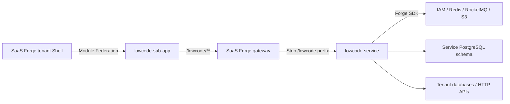

# Lowcode

[简体中文](README.md) | English

A multitenant low-code data screen application built on [SaaS Forge](https://github.com/crane199709/saas-forge). Tenants connect their own databases or HTTP APIs, define datasets, and use a visual editor to build, publish, and play data screens.

## Relationship with SaaS Forge

**SaaS Forge provides the platform; this repository implements the low-code application.** The backend was generated with `forge-service-archetype`, and the frontend follows the `sub-app-kit` Sub-App contract. Both projects are maintained and built independently in this repository and connect to SaaS Forge services and its tenant Shell at runtime.

| Layer                                | Responsibility                                                                                                                                                                   |
| ------------------------------------ | -------------------------------------------------------------------------------------------------------------------------------------------------------------------------------- |
| SaaS Forge platform                  | IAM, tenants and memberships, plan entitlements, permissions and data policies, App Registry, platform console, and tenant Shell                                                 |
| Forge SDK and frontend tooling       | Authentication, tenant context, permission enforcement, database tenant isolation, Manifest reporting, messaging and provisioning, audit, storage, shared UI, and Sub-App builds |
| `lowcode-service` in this repository | Data source connections, dataset queries and aggregation, screen drafts and published snapshots, image access, reference protection, and service-owned Flyway migrations         |
| `lowcode-sub-app` in this repository | Data source, dataset, and screen lists, the visual editor, and playback pages; calls business APIs through the tenant client                                                     |



Service discovery and configuration use the platform's Nacos instance. The service schema in PostgreSQL stores the application's own business data; tenant databases and APIs provide the data queried for screens.

| Integration identifier               | Current value                                                                                             |
| ------------------------------------ | --------------------------------------------------------------------------------------------------------- |
| Backend service name                 | `lowcode-service`                                                                                         |
| Gateway prefix and Realm             | `/lowcode`, Tenant Realm                                                                                  |
| Sub-App code and route               | `lowcode`, mounted at `/apps/lowcode`                                                                     |
| Federated module and build entry     | `./sub-app`, `dist/remoteEntry.js`                                                                        |
| Forge BOM / frontend tooling version | `0.2.0-SNAPSHOT`; see [pom.xml](lowcode-service/pom.xml) and [package.json](lowcode-sub-app/package.json) |

This project also validates SaaS Forge's scaffolding, SDK, and onboarding documentation against a real application. Application specifications and issues live in [`.scratch/lowcode-v1/`](.scratch/lowcode-v1/spec.md); platform issues are tracked in `.scratch/lowcode-validation/issues/` in the SaaS Forge repository.

> [!IMPORTANT]
> The frontend currently uses platform source snapshot packages in [`.forge-packages/`](.forge-packages/) through [pnpm overrides](lowcode-sub-app/pnpm-workspace.yaml). Shared dependencies must match the actual tenant Shell. Check the backend BOM, frontend dependencies, and Shell together when upgrading; remove the temporary overrides and tarballs after switching to published packages.

## Current capabilities

- **Data sources:** PostgreSQL, MySQL, SQL Server, Oracle, ClickHouse, and HTTP JSON APIs, with connection testing and database table/column browsing.
- **Datasets:** SQL or API queries, result previews, field types and dimension/measure settings, aggregation, date grouping, static filters, sorting, and Top N.
- **Screen editing:** A free-form canvas with dragging, resizing, grid snapping, layers, duplication, and undo/redo. Widgets include detail and summary tables, indicators, text, line charts, bar and stacked bar charts, pie/donut charts, and images.
- **Publishing and playback:** Drafts, published snapshots, three canvas scaling modes, and per-widget refresh intervals. Images and backgrounds use S3-compatible storage.
- **Platform permissions:** Seven permission codes, designer/viewer role templates, and a `screen` data resource with visibility controlled by creator, department, and other data scopes.

Publishing freezes layout and widget configuration while datasets remain live, so dataset changes affect published screens. Referenced data sources cannot be deleted, and datasets cannot be deleted while referenced by a draft or published snapshot. Anonymous sharing, relational modeling, cross-source joins, widget interactions, and publication history/rollback are outside the current scope. See the [v1 specification](.scratch/lowcode-v1/spec.md) for details.

## Repository layout

```text
lowcode-service/           Java 17 / Spring Boot business service
  src/main/java/          Business code, including datasource and screen
  src/main/resources/     Configuration, Manifest, Flyway migrations, Mapper XML
  src/test/               Testcontainers, permissions, isolation, business tests
lowcode-sub-app/          Vue 3 / TypeScript / Vite / ECharts Sub-App
  src/sub-app.ts          Relative routes loaded by the tenant Shell
  src/dev.ts              Standalone development host entry
  e2e/visual/             Interaction and visual tests with mocked APIs
  e2e/platform/           Browser acceptance tests against the real platform
.forge-packages/          Temporary platform frontend snapshot packages
deploy/e2e/               Isolated platform acceptance runner
docs/adr/                 Architecture decisions
GLOSSARY.md               Domain terminology
.scratch/lowcode-v1/      Specification, issues, reviews, and acceptance records
```

## Local development

### 1. Prepare the platform and dependencies

Use JDK 17, Node.js 24+, and pnpm 12. The backend includes Maven Wrapper. Integration tests require Docker; browser tests require Playwright Chromium.

Follow the [SaaS Forge local setup](https://github.com/crane199709/saas-forge#本地启动) to prepare platform services, PostgreSQL, Redis, Nacos, RocketMQ, and S3-compatible storage. Before building the backend, make sure Maven can resolve `io.saasforge:*:0.2.0-SNAPSHOT`. With matching platform source, run `./mvnw install -DskipTests` in its `backend/` directory to install local artifacts. Unless stated otherwise, commands below start at this repository's root.

### 2. Configure and start the backend

Follow the [platform onboarding checklist](https://github.com/crane199709/saas-forge/blob/main/docs/service-onboarding-checklist.md) to provision a dedicated schema, migration account, and runtime account for lowcode, then copy the environment template:

```bash
cd lowcode-service
cp .env.example .env.local
```

Fill in every variable in `.env.local`. See [`.env.example`](lowcode-service/.env.example) for descriptions and [application.yml](lowcode-service/src/main/resources/application.yml) for bindings. Configuration covers the service port, Nacos, both database accounts, Redis, RocketMQ, Tenant Realm issuer/JWKS, IAM, Manifest and Ops tokens, object storage, and data source security settings.

- `LOWCODE_DATASOURCE_BLOCKED_NETWORKS`: CIDR ranges that data source connections must not access, typically the platform's internal networks.
- `LOWCODE_DATASOURCE_ENCRYPTION_KEY`: A Base64-encoded 32-byte AES key for database passwords and sensitive API headers. Retain the original key when data already exists.
- The S3 endpoint must be reachable from the browser. Create the bucket in advance and allow cross-origin PUT/GET from the Sub-App origin.

Load the variables and start the service in the same terminal:

```bash
set -a
source .env.local
set +a
./mvnw spring-boot:run
```

Spring Boot does not load `.env.local` automatically; Git ignores this file. Flyway uses the migration account at startup, while application connections use the runtime account. Use read-only accounts for external database data sources: SQL validation cannot replace database account permissions.

### 3. Start the frontend development host

In another terminal, from this repository's root:

```bash
cd lowcode-sub-app
pnpm install --frozen-lockfile
pnpm dev
```

Open [http://localhost:5176](http://localhost:5176). The standalone host supports HMR and proxies `/iam` and `/lowcode` to `http://localhost:8080`. It includes a minimal login UI; real login and data access still require platform services and the backend. For a different gateway address, set `gateway` in `defineSubAppConfig` in [vite.config.ts](lowcode-sub-app/vite.config.ts).

### 4. Integrate with the real tenant Shell

From `lowcode-sub-app/`, run:

```bash
pnpm start:lowcode
```

This builds the app and serves [http://127.0.0.1:5176/remoteEntry.js](http://127.0.0.1:5176/remoteEntry.js). Rerun after source changes. For deployment, publish the entire `dist/` directory and configure resource CORS for the target Shell. Local preview allows the HTTP origins `localhost:5174` and `127.0.0.1:5174` by default; use `shellOrigins` for other origins.

Complete the platform integration steps below; see the [onboarding checklist](https://github.com/crane199709/saas-forge/blob/main/docs/service-onboarding-checklist.md) for procedures:

1. Configure a Manifest token and a separate Ops token for `lowcode-service`, matching the values registered in IAM and platform respectively. Confirm that the [Manifest](lowcode-service/src/main/resources/META-INF/forge/manifest.json) is reported successfully.
2. Prepare the `forge-tenant`, `forge-app`, and `forge-audit` topics and add `lowcode-service` to `forge.platform.provisioning.services`. The current initializer acknowledges provisioning without creating data sources, datasets, or screens.
3. Add a `/lowcode/**` → `lb://lowcode-service` gateway route in Nacos with `StripPrefix=1`, and declare the `/lowcode` prefix with the `tenant` Realm.
4. When using the local tenant Shell development server, add a `/lowcode` proxy to the gateway in the platform's `frontend/apps/tenant-app/vite.config.ts`. The Sub-App's `apiPrefixes` only configures its own development host.
5. Register code `lowcode`, the current environment's entry URL, and shared dependency requirements in App Registry. Enable the app and required permissions in the tenant's plan, then assign member roles and screen data scopes.

Members can then access data source, dataset, and screen pages under `/apps/lowcode` in the tenant Shell. Viewers can play published screens within their authorized scope. The Platform Realm Token used by the platform console cannot call this application's Tenant Realm APIs.

## Verification

GitHub Actions runs backend verification, frontend builds, and interaction tests on pushes to `main`, pull requests, and manual dispatch. See the [CI guide](docs/ci.md) for snapshot dependencies, reports, and the limits of screenshot checks.

In `lowcode-service/`:

```bash
./mvnw verify
# Include the slower Oracle container tests
./mvnw verify -Pslow-dialects
```

Default verification includes business tests, tenant isolation and permissions, architecture rules, schema comments, and Spotless checks. External database coverage includes PostgreSQL, MySQL, SQL Server, and ClickHouse. SQL Server images are amd64-only; on Apple Silicon, prepare Docker Rosetta as described in the [backend instructions](lowcode-service/AGENTS.md).

In `lowcode-sub-app/`:

```bash
pnpm build
pnpm format:check
pnpm exec playwright install chromium
pnpm test:visual
```

`build` includes isolation checks, style token checks, and type checking. Visual tests mock APIs and need no backend; compare screenshots on the same platform as the baselines.

Run real platform acceptance from the repository root, supplying a prepared SaaS Forge source checkout and setting `JAVA_HOME` to Java 17:

```bash
./deploy/e2e/run.sh --platform-root /absolute/path/to/saas-forge
```

The runner uses isolated containers, volumes, accounts, and ports. It verifies app registration, plan entitlements, tenant provisioning, screen editing and publishing, image upload, playback, permission scopes, and audit, then cleans up its resources. See the [E2E guide](deploy/e2e/README.md) for prerequisites and options. The [acceptance record](.scratch/lowcode-v1/acceptance.md) documents historical runs and their limits; it does not establish that an existing development environment is integrated.

## Further reading

- [Domain terminology](GLOSSARY.md), [architecture decisions](docs/adr/), and [v1 specification](.scratch/lowcode-v1/spec.md)
- [Backend conventions](lowcode-service/AGENTS.md) and [frontend conventions](lowcode-sub-app/AGENTS.md)
- SaaS Forge: [business service guide](https://github.com/crane199709/saas-forge/blob/main/docs/business-service-guide.md), [platform onboarding checklist](https://github.com/crane199709/saas-forge/blob/main/docs/service-onboarding-checklist.md), and [Sub-App integration](https://github.com/crane199709/saas-forge/blob/main/docs/sub-app.md)
