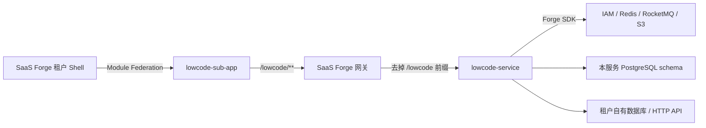

# Lowcode

简体中文 | [English](README-en.md)

基于 [SaaS Forge](https://github.com/crane199709/saas-forge) 的多租户低代码数据大屏应用。租户接入自有数据库或 HTTP API，定义数据集，再通过可视化编辑器搭建、发布和播放大屏。

## 与 SaaS Forge 的关系

**SaaS Forge 提供平台底座，本仓库实现低代码业务。** 本仓库的后端由 `forge-service-archetype` 生成，前端遵循 `sub-app-kit` 的 Sub-App 契约；两个子工程在本仓库独立维护和构建，运行时接入 SaaS Forge 的服务与租户 Shell。

| 层次                     | 职责                                                                                                                   |
| ------------------------ | ---------------------------------------------------------------------------------------------------------------------- |
| SaaS Forge 平台          | 提供 IAM、租户与成员管理、套餐授权、权限与数据策略、应用注册表、平台控制台和租户 Shell                                 |
| Forge SDK 与前端工具包   | 提供认证、租户上下文、权限校验、数据库租户隔离、Manifest 上报、消息与开通、审计、存储，以及共享 UI 和 Sub-App 构建能力 |
| 本仓库 `lowcode-service` | 实现数据源连接、数据集查询与聚合、大屏草稿与发布快照、图片访问和业务引用保护；维护本服务的 Flyway 迁移                 |
| 本仓库 `lowcode-sub-app` | 实现数据源、数据集、大屏列表、可视化编辑器与播放页面；通过租户客户端调用业务 API                                       |



服务注册与配置使用平台的 Nacos。平台数据库中的服务 schema 保存低代码业务数据；租户登记的外部数据库与 API 是大屏查询的数据来源，两者用途不同。

| 接入标识                   | 当前值                                                                                                  |
| -------------------------- | ------------------------------------------------------------------------------------------------------- |
| 后端服务注册名             | `lowcode-service`                                                                                       |
| 网关前缀与 Realm           | `/lowcode`，Tenant Realm                                                                                |
| Sub-App 编码与路由         | `lowcode`，挂载在 `/apps/lowcode`                                                                       |
| 联邦模块与构建入口         | `./sub-app`，`dist/remoteEntry.js`                                                                      |
| Forge BOM / 前端工具包版本 | `0.2.0-SNAPSHOT`，见 [pom.xml](lowcode-service/pom.xml) 与 [package.json](lowcode-sub-app/package.json) |

本项目同时用于验证 SaaS Forge 的脚手架、SDK 和接入指南能否承载真实业务。本仓库的业务规格与工单位于 [`.scratch/lowcode-v1/`](.scratch/lowcode-v1/spec.md)；平台能力的问题反馈到 SaaS Forge 仓库的 `.scratch/lowcode-validation/issues/`。

> [!IMPORTANT]
> 当前前端通过 [pnpm overrides](lowcode-sub-app/pnpm-workspace.yaml) 使用 [`.forge-packages/`](.forge-packages/) 中的平台源码 snapshot 包。实际租户 Shell 的共享依赖须与之匹配。升级时同步核对后端 BOM、前端依赖与 Shell；切换到正式发布包后再移除临时 overrides 和 tarball。

## 当前能力

- **数据接入**：PostgreSQL、MySQL、SQL Server、Oracle、ClickHouse 和 HTTP JSON API；支持测试连接，数据库支持浏览表与列。
- **数据集**：SQL 或 API 查询、结果预览、字段类型与维度/度量配置；支持分组聚合、日期分组、静态过滤、排序与 Top N。
- **大屏编辑**：自由画布、拖拽缩放、网格吸附、层级、复制、撤销/重做；支持明细表、汇总表、指标卡、文本、折线图、柱状图、堆叠柱状图、饼图/环形图和图片。
- **发布与播放**：保存草稿、发布快照、三种画布适配方式与组件定时刷新；图片与背景图通过 S3 兼容存储上传和读取。
- **平台权限接入**：声明 7 个权限码、设计者/查看者角色模板和 `screen` 数据资源；大屏按创建人、部门等数据范围控制可见性。

发布冻结布局与组件配置，数据集仍实时生效；修改数据集会影响已发布大屏。数据源被数据集引用、数据集被草稿或发布快照引用时禁止删除。当前范围不包含匿名分享、多表关联建模、跨源关联、组件联动、发布历史与回滚，完整边界见 [一期规格](.scratch/lowcode-v1/spec.md)。

## 仓库结构

```text
lowcode-service/           Java 17 / Spring Boot 业务服务
  src/main/java/          datasource、screen 等业务代码
  src/main/resources/     应用配置、Manifest、Flyway 迁移与 Mapper XML
  src/test/               Testcontainers、权限、隔离与业务回归
lowcode-sub-app/          Vue 3 / TypeScript / Vite / ECharts 子应用
  src/sub-app.ts          供租户 Shell 加载的相对路由
  src/dev.ts              独立开发宿主入口
  e2e/visual/             mock API 的交互与视觉回归
  e2e/platform/           真实平台浏览器验收
.forge-packages/          临时使用的平台前端 snapshot 包
deploy/e2e/               隔离平台验收运行器
docs/adr/                 架构决策
GLOSSARY.md               业务术语
.scratch/lowcode-v1/      规格、工单、审查与验收记录
```

## 本地开发

### 1. 准备平台与依赖

需要 JDK 17、Node.js 24+、pnpm 12；后端使用自带 Maven Wrapper。集成测试需要 Docker，浏览器测试需要 Playwright Chromium。

先按 [SaaS Forge 本地启动说明](https://github.com/crane199709/saas-forge#本地启动)准备平台服务和 PostgreSQL、Redis、Nacos、RocketMQ、S3 兼容存储。构建后端前，Maven 仓库须能解析 `io.saasforge:*:0.2.0-SNAPSHOT`；使用匹配的平台源码时，可在其 `backend/` 目录执行 `./mvnw install -DskipTests` 安装本地制品。本文命令除特别说明外从本仓库根目录开始。

### 2. 配置并启动后端

先按[平台侧接入清单](https://github.com/crane199709/saas-forge/blob/main/docs/service-onboarding-checklist.md)为 lowcode 准备独立 schema、迁移账号与运行账号，然后复制配置模板：

```bash
cd lowcode-service
cp .env.example .env.local
```

填写 `.env.local` 的所有变量；变量说明见 [`.env.example`](lowcode-service/.env.example)，实际绑定见 [application.yml](lowcode-service/src/main/resources/application.yml)。配置涵盖服务端口、Nacos、数据库双账号、Redis、RocketMQ、Tenant Realm issuer/JWKS、IAM、Manifest 与 Ops 令牌、对象存储，以及数据源安全设置。

- `LOWCODE_DATASOURCE_BLOCKED_NETWORKS`：本环境禁止数据源访问的 CIDR 网段，通常为平台内网。
- `LOWCODE_DATASOURCE_ENCRYPTION_KEY`：Base64 编码的 32 字节 AES 密钥，用于加密数据库密码和 API 敏感请求头；已有数据须沿用原密钥。
- S3 endpoint 须可被浏览器访问，bucket 须预建，并允许子应用所在源的跨域 PUT/GET。

在同一终端加载变量并启动：

```bash
set -a
source .env.local
set +a
./mvnw spring-boot:run
```

Spring Boot 不会自动读取 `.env.local`；该文件已被 Git 忽略。服务启动时由迁移账号执行 Flyway，业务连接使用运行账号。外部数据库数据源应使用只读账号，SQL 校验不能替代数据库账号权限。

### 3. 启动前端开发宿主

在另一个终端，从本仓库根目录执行：

```bash
cd lowcode-sub-app
pnpm install --frozen-lockfile
pnpm dev
```

打开 [http://localhost:5176](http://localhost:5176)。独立开发宿主支持 HMR，并将 `/iam`、`/lowcode` 请求代理到 `http://localhost:8080`。它提供最小登录界面，实际登录和取数仍依赖平台与后端；网关地址不同时，在 [vite.config.ts](lowcode-sub-app/vite.config.ts) 的 `defineSubAppConfig` 中配置 `gateway`。

### 4. 接入真实租户 Shell

从 `lowcode-sub-app/` 执行：

```bash
pnpm start:lowcode
```

该命令先构建，再提供 [http://127.0.0.1:5176/remoteEntry.js](http://127.0.0.1:5176/remoteEntry.js)。源码修改后需重新执行。部署时发布整个 `dist/`，并为目标 Shell 配置资源 CORS；本地 preview 默认允许 `localhost:5174` 与 `127.0.0.1:5174` 两个 HTTP 源，其他源通过 `shellOrigins` 指定。

平台侧需完成以下接入，具体操作见[接入清单](https://github.com/crane199709/saas-forge/blob/main/docs/service-onboarding-checklist.md)：

1. 为 `lowcode-service` 配置 Manifest 上报令牌，以及独立的 Ops 令牌，分别与 IAM 和 platform 的登记值保持一致；确认 [Manifest](lowcode-service/src/main/resources/META-INF/forge/manifest.json) 上报成功。
2. 准备 `forge-tenant`、`forge-app`、`forge-audit` Topic，并将 `lowcode-service` 加入 `forge.platform.provisioning.services`。当前初始化器只确认开通，不预置数据源、数据集或大屏。
3. 在 Nacos 的网关配置中追加 `/lowcode/**` → `lb://lowcode-service` 路由，设置 `StripPrefix=1`，并声明 `/lowcode` 使用 `tenant` Realm。
4. 本地通过租户 Shell 开发服务器联调时，在平台的 `frontend/apps/tenant-app/vite.config.ts` 中追加 `/lowcode` 到网关的代理；子应用的 `apiPrefixes` 仅配置自身开发宿主。
5. 在 App Registry 登记编码 `lowcode`、当前环境的入口 URL 和共享依赖要求；在租户套餐中开放应用及所需权限，再为成员分配角色和大屏数据范围。

接入成功后，成员在租户 Shell 的 `/apps/lowcode` 下访问数据源、数据集与大屏页面。查看者可播放授权范围内已发布的大屏，平台控制台使用的 Platform Realm Token 无法调用本业务的 Tenant Realm 接口。

## 验证

在 `lowcode-service/` 中执行：

```bash
./mvnw verify
# Oracle 慢速容器测试需单独启用
./mvnw verify -Pslow-dialects
```

默认 `verify` 包括业务测试、租户隔离与权限测试、架构规则、表字段注释和 Spotless 检查，外部数据库覆盖 PostgreSQL、MySQL、SQL Server 与 ClickHouse。SQL Server 镜像仅支持 amd64，Apple Silicon 环境需按[后端说明](lowcode-service/AGENTS.md)准备 Docker Rosetta。

在 `lowcode-sub-app/` 中执行：

```bash
pnpm build
pnpm format:check
pnpm exec playwright install chromium
pnpm test:visual
```

`build` 包含隔离约定检查、样式 token 检查和类型检查。视觉测试 mock API，无需启动后端；截图应在与基线一致的平台上比对。

从仓库根目录运行真实平台验收，显式指定已准备好的 SaaS Forge 源码路径与 Java 17 的 `JAVA_HOME`：

```bash
./deploy/e2e/run.sh --platform-root /absolute/path/to/saas-forge
```

运行器使用独立容器、数据卷、账号与端口，验证应用登记、套餐授权、租户开通、设计发布、图片上传、播放、权限范围与审计，并清理本轮资源。环境前提及参数见 [E2E 说明](deploy/e2e/README.md)。[已有验收记录](.scratch/lowcode-v1/acceptance.md)保留了历史执行结果与验证边界，不代表现有开发环境已完成接入。

## 进一步阅读

- [业务术语](GLOSSARY.md)、[架构决策](docs/adr/)、[一期规格](.scratch/lowcode-v1/spec.md)
- [后端约定](lowcode-service/AGENTS.md)与[前端约定](lowcode-sub-app/AGENTS.md)
- SaaS Forge：[业务服务接入指南](https://github.com/crane199709/saas-forge/blob/main/docs/business-service-guide.md)、[平台侧接入清单](https://github.com/crane199709/saas-forge/blob/main/docs/service-onboarding-checklist.md)、[Sub-App 接入](https://github.com/crane199709/saas-forge/blob/main/docs/sub-app.md)
